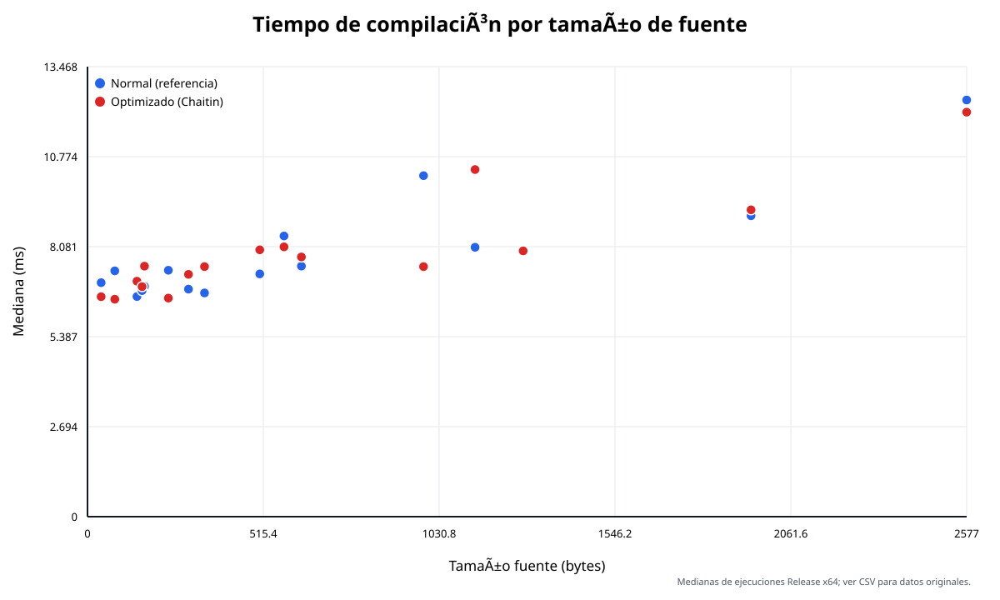
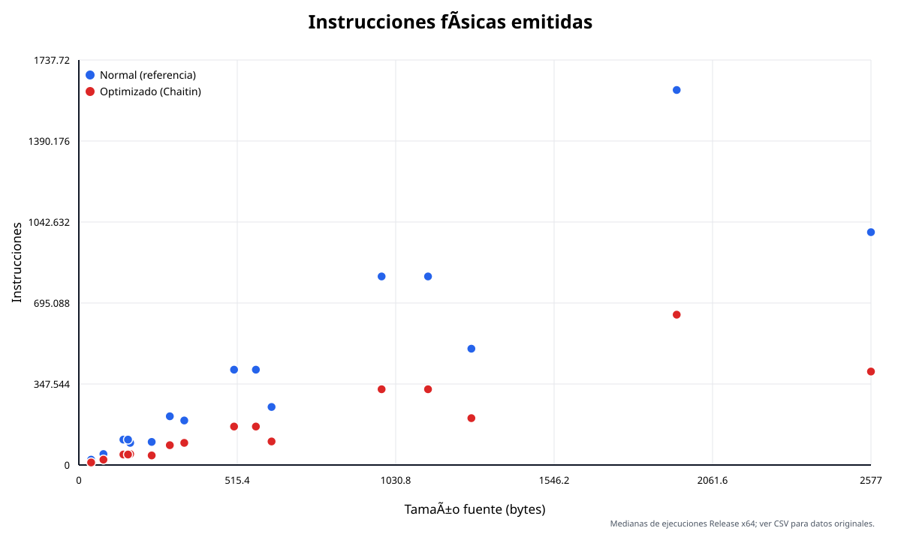
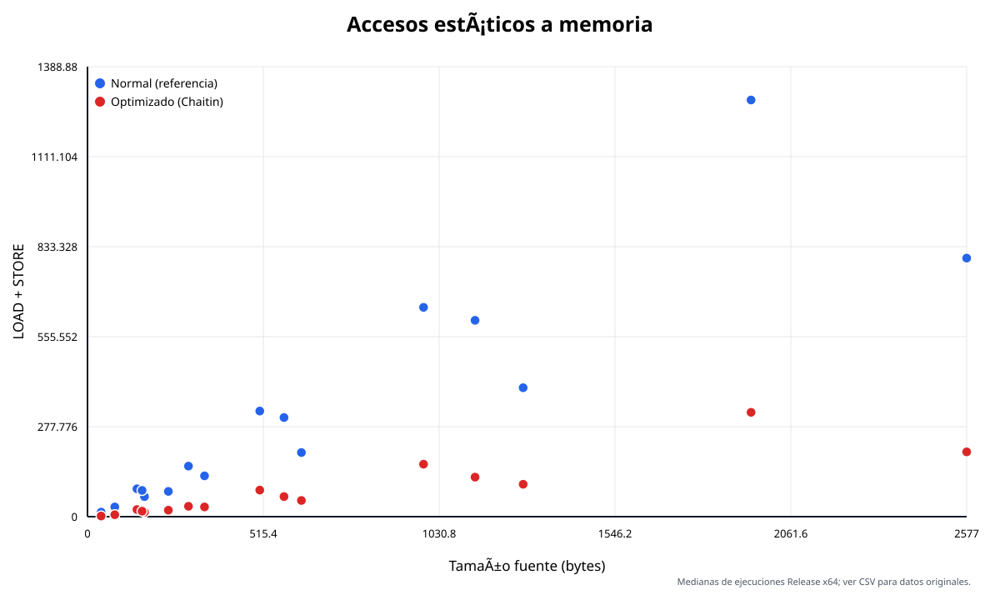
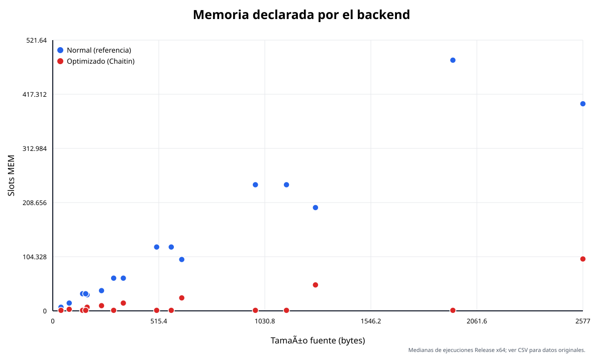
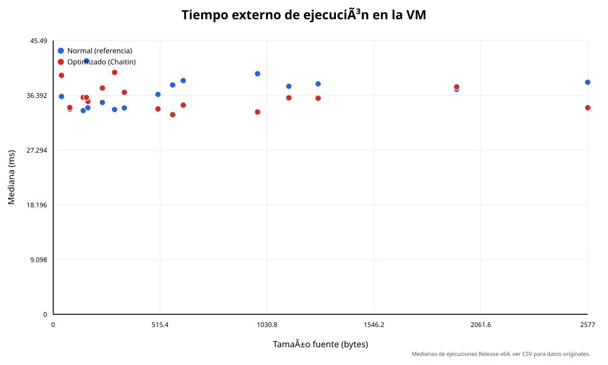
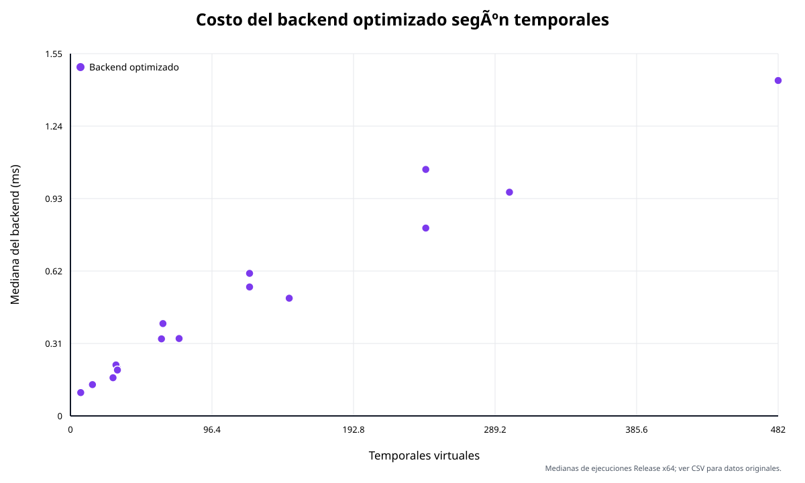

# L-Cero: compilador y máquina virtual abstracta

## Anexo técnico de implementación, ejecución y evaluación experimental

**Propósito:** documento técnico de transferencia para la preparación del informe académico definitivo.  
**Fecha:** 24 de octubre de 2026.  
**Integrantes:** ________________________________________________  
**Docente / comisión:** _________________________________________

> Este anexo documenta la implementación y la evidencia disponible. No reemplaza
> el informe académico principal ni atribuye a las pruebas empíricas el valor de
> una demostración matemática.

---

## Índice

1. Introducción y alcance
2. Fuentes, método y jerarquía de evidencia
3. Arquitectura general
4. Especificación efectiva de L-Cero
5. Analizador léxico y AFD mínimo
6. Parser LL(1) y AST
7. Análisis semántico
8. Representación intermedia y backends
9. Máquina virtual
10. Contrato compilador–VM
11. Procedimiento real de ejecución
12. Pruebas automatizadas y validación
13. Optimización mediante Chaitin
14. Complejidad computacional
15. Profiling experimental
16. Gráficos comparativos
17. Computabilidad e indecidibilidad
18. Ejemplo integral verificable
19. Correspondencia con la consigna institucional
20. Textos, tablas y figuras listos para el informe
21. Inventario de fuentes y trazabilidad
22. Conclusiones y recomendaciones

---

# 1. Introducción y alcance

L-Cero es un mini lenguaje imperativo construido para integrar contenidos de
Jerarquía de Chomsky, teoría de autómatas, computabilidad y complejidad. El
sistema se divide en dos aplicaciones C++17 independientes:

- el compilador recibe un programa `.lc`, realiza análisis léxico, sintáctico y
  semántico, construye una representación intermedia y emite `LCERO_IR 1`;
- la máquina virtual carga un `.lci`, lo valida completamente y ejecuta sus
  instrucciones sobre un estado abstracto de registros y memoria.

La consigna institucional organiza el trabajo en tres hitos y ocho fases:

| Hito | Fases |
|---|---|
| I. Análisis léxico y sintáctico | 1 Lexer, 2 Parser, 3 Semántica |
| II. RI y máquina abstracta | 4 Compilación/intérprete, 5 máquina universal, 6 indecidibilidad |
| III. Optimización y recursos | 7 análisis asintótico/profiling, 8 registros/NP-completitud |

El presente anexo reúne los datos técnicos que otro integrante puede trasladar
al informe final. Explica qué exige la consigna, qué implementa realmente el
software, qué fue medido y qué sigue siendo parcial. No modifica los proyectos,
el contrato, las pruebas, los CSV ni los gráficos originales.

# 2. Fuentes, método y jerarquía de evidencia

## 2.1 Fuentes examinadas

Se utilizaron, en este orden de autoridad según el tipo de afirmación:

1. `ENUNCIADO-Evaluacion-Parcial-2-A.pdf`, para requisitos institucionales;
2. código fuente de `Compilador/` y `VM/`, para comportamiento real;
3. contrato congelado en `VM/docs/contract/RI-v1.md` y Documento Maestro;
4. documentos `Compilador/docs/modulo_0...modulo_5` y el informe general del
   Módulo 6 en `documentacion/`;
5. suites, manifiestos y casos de prueba;
6. CSV de `Compilador/integration/results/` para cifras experimentales;
7. scripts de integración, profiling y generación de gráficos;
8. programas `.lc`, `.lci`, salidas esperadas y artefactos ejecutados.

La consigna institucional tiene siete páginas convertibles a texto y exige,
entre otros entregables, código modular, manejo de errores, pruebas con fuentes
válidos, inválidos léxicos, inválidos sintácticos y bucles infinitos; un informe
formal con autómatas, FIRST/FOLLOW, indecidibilidad, NP-completitud y profiling;
y una defensa oral de hasta siete minutos.

## 2.2 Criterio para resolver discrepancias

Una afirmación sobre “lo exigido” sigue el PDF. Una afirmación sobre “lo que el
software hace” sigue el código y sus pruebas. Una cifra sigue el CSV crudo, no
un resumen histórico. Los documentos de módulos describen decisiones y pruebas
de su etapa, pero los totales históricos —30, 42, 53, 60, 70— no reemplazan el
resultado final de 71 pruebas.

Se distinguen cuatro niveles:

- **demostrado:** existe argumento matemático con hipótesis y conclusión;
- **verificado:** una propiedad concreta fue comprobada algorítmicamente;
- **observado:** una ejecución o medición produjo determinado resultado;
- **pendiente/parcial:** la evidencia no alcanza el enunciado literal.

# 3. Arquitectura general

```text
Programa fuente .lc
        |
        v
Lectura e invalidación segura de salida anterior
        |
        v
Lexer: AFN -> AFD -> AFD mínimo -> tokens
        |
        v
Parser predictivo LL(1) -> AST
        |
        v
Semántica: tabla de símbolos e inicialización definida
        |
        v
RI tipada de tres direcciones
        |
        +---------------------------+
        |                           |
        v                           v
Backend reference        CFG + vivacidad + interferencia
                                      |
                                      v
                                Chaitin + spilling
                                      |
        +-----------------------------+
        v
Validador LCERO_IR 1 -> publicación transaccional .lci
        |
        v
Copia física verificada por SHA-256
        |
        v
Loader y validador de la VM
        |
        v
Intérprete -> stdout, estado, pasos y código de salida
```

## 3.1 Proyectos independientes

| Componente | Solución | Ejecutable Release x64 |
|---|---|---|
| Compilador | `Compilador/LCero-Compilador.slnx` | `Compilador/bin/x64/Release/LCero.Compiler.exe` |
| VM | `VM/LCero-VM.slnx` | `VM/bin/x64/Release/lcero-vm.exe` |

No existe referencia de proyecto ni biblioteca compartida entre ambos. La
frontera es un archivo textual `.lci`. Esta separación permite validar cada
componente de manera independiente, evita que la VM dependa de objetos privados
del compilador y materializa el contrato como artefacto auditable.

El compilador decide sintaxis fuente, semántica, temporales, asignación de
registros y spilling. La VM no optimiza: valida y ejecuta exactamente las
instrucciones recibidas. La VM no acepta `.lc`, tokens ni AST.

# 4. Especificación efectiva de L-Cero

## 4.1 Construcciones admitidas

- tipo único `int`, con declaraciones globales al comienzo;
- asignaciones separadas de la declaración;
- enteros decimales no negativos como tokens y menos unario en la gramática;
- `+`, `-`, `*`, `/`, paréntesis, precedencia usual y asociatividad izquierda;
- comparadores `==`, `!=`, `<`, `>`, `<=`, `>=`;
- `if` con `else` opcional y bloques no vacíos;
- `while` con condición comparativa y bloque no vacío;
- `print(expresion);`;
- enteros matemáticos sin límite fijo de bits en la interfaz, representados en
  la VM mediante `boost::multiprecision::cpp_int`.

No existen funciones, tipos adicionales, comentarios, cadenas, booleanos,
operadores lógicos, declaración con inicializador ni bloques vacíos. Todos los
identificadores tienen ámbito global. Un programa debe contener al menos una
instrucción.

## 4.2 Reglas semánticas y dinámicas

Una variable debe declararse una sola vez y estar definitivamente inicializada
antes de leerse. El analizador es conservador: una inicialización realizada sólo
en un `if` sin `else` o sólo dentro de un `while` no se propaga a la salida. La
división por cero no es error estático; se detecta durante la ejecución.

La división entera trunca hacia cero: `-7 / 2 = -3`. Las comparaciones producen
exactamente `0` o `1`. Un registro o slot no inicializado produce error dinámico.

## 4.3 Programa representativo

```c
int x;
int suma;
x = 1;
suma = 0;
while (x <= 4) {
    if (x == 2) { suma = suma + 10; }
    else { suma = suma + x; }
    x = x + 1;
}
print(suma);
```

El programa declara antes de usar, inicializa ambas variables, reevalúa la
condición del `while` en cada iteración y produce `18`. Su estructura utiliza
únicamente construcciones presentes en la gramática real.

# 5. Analizador léxico y AFD mínimo

## 5.1 Alfabeto y expresiones regulares

El alfabeto de caracteres es:

```text
Σ = L ∪ D ∪ O ∪ S ∪ B
L = {a..z, A..Z}
D = {0..9}
O = {+, -, *, /, =, !, <, >}
S = {(, ), {, }, ;, _}
B = {SPACE, TAB, CR, LF}
```

Los conjuntos son disjuntos y `|Σ| = 80`. `EOF` es un marcador interno. El
fuente se procesa como bytes y sólo se admite el subconjunto ASCII especificado.

```text
ID         = [A-Za-z_][A-Za-z0-9_]*
NUMBER     = [0-9]+
WHITESPACE = [ \t\r\n]+
```

Las palabras `int`, `if`, `else`, `while` y `print`, los operadores y los
delimitadores son lenguajes singleton. El signo menos no integra `NUMBER`:
`-25` se tokeniza como `MINUS NUMBER("25")`.

## 5.2 Clases de tokens

| Familia | Tokens |
|---|---|
| Reservadas | `KW_INT`, `KW_IF`, `KW_ELSE`, `KW_WHILE`, `KW_PRINT` |
| Generales | `ID`, `NUMBER` |
| Aritméticos | `PLUS`, `MINUS`, `STAR`, `SLASH` |
| Relacionales | `EQ`, `NE`, `LT`, `GT`, `LE`, `GE` |
| Asignación | `ASSIGN` |
| Delimitadores | `LPAREN`, `RPAREN`, `LBRACE`, `RBRACE`, `SEMICOLON` |
| Internos | `WHITESPACE` descartado, `EOF` agregado |

## 5.3 Construcción formal

`Nfa::build_lexer_nfa` construye manualmente 24 ramas. Un estado inicial nuevo
se conecta por ε a las ramas literales y a los patrones `ID`, `NUMBER` y blancos.
La quíntupla resultante posee 67 estados, `N0...N66`. Cada final lleva tipo y
prioridad observable; esto resuelve la superposición entre reservadas e `ID`.

`Dfa::determinize` aplica la construcción por subconjuntos con clausura ε y
produce 40 estados alcanzables, incluido el conjunto vacío. `Dfa::minimize`
refina particiones preservando el tipo de token. La sucesión tiene 25, 32, 35,
38 y finalmente 40 bloques singleton. Una tabla de pares distinguibles confirma
que no queda ningún par fusionable. Por tanto, el AFD completo de 40 estados es
mínimo respecto de la salida léxica.

| Magnitud | Valor |
|---|---:|
| Estados AFN | 67 |
| Estados AFD por subconjuntos | 40 |
| Estados AFD mínimo | 40 |
| Estado sumidero mínimo | `M21` |
| Clases de símbolos compactadas | 27 |

## 5.4 Matriz de transición

La matriz completa exigida por la Fase 1 está en:

`Compilador/docs/automatas/afd_minimo_transiciones.csv`

Tiene 40 filas y 27 columnas de clases de símbolos. La expansión de cada clase
está en `clases_simbolos.csv`; los subconjuntos del AFD, en
`afd_subconjuntos.csv`; las ramas AFN, en `afn_ramas.csv`; y la traza de
minimización, en `minimizacion_particiones.txt`. Estos archivos deben adjuntarse
o referenciarse inequívocamente desde el informe; una captura parcial no
reemplaza la matriz íntegra.

## 5.5 Reconocimiento y errores

`Lexer::tokenize` recorre exclusivamente el AFD mínimo. Desde `M0` avanza hasta
antes del sumidero, recuerda la última aceptación y aplica máxima coincidencia.
La prioridad decide sólo si el mismo subconjunto contiene varios finales.
Ejemplos: `==` es `EQ`, `=` es `ASSIGN`, `while2` es `ID` y `while` es
`KW_WHILE`.

Los tokens guardan tipo, lexema, línea, columna y offset. El primer byte no
reconocible produce diagnóstico `Lexical` y detiene esa fase. No se confunde un
error gramatical con un error léxico.

## 5.6 Complejidad y evidencia

Con el autómata fijo, cada byte provoca un número constante de consultas de
tabla y, a lo sumo, un lookahead reconsiderado. El reconocimiento es `Θ(n)` en
tiempo y `O(n+t)` en espacio por el fuente y los tokens. La construcción de los
autómatas depende de la especificación, no del tamaño del programa concreto.

La suite verifica totalidad, alcance, equivalencia AFD/AFD mínimo, ausencia de
pares equivalentes y 16.105 cadenas representativas de longitud hasta cuatro.

# 6. Parser LL(1) y AST

## 6.1 Gramática efectiva

La gramática tiene 20 no terminales, 24 terminales y 38 producciones. El símbolo
inicial es `Programa`. El archivo íntegro es
`Compilador/docs/gramatica/lcero_bnf.txt`. Extracto:

```text
Programa    -> DeclSeq StmtSeq EOF
DeclSeq     -> Declaracion DeclSeq | ε
Declaracion -> KW_INT ID SEMICOLON
Instruccion -> Asignacion | Impresion | Condicional | Bucle
Condicional -> KW_IF LPAREN Condicion RPAREN Bloque ElseOpt
ElseOpt     -> KW_ELSE Bloque | ε
Bucle       -> KW_WHILE LPAREN Condicion RPAREN Bloque
Condicion   -> Expresion Comparador Expresion
Expresion   -> Termino ExprTail
ExprTail    -> PLUS Termino ExprTail | MINUS Termino ExprTail | ε
Termino     -> Unario TermTail
TermTail    -> STAR Unario TermTail | SLASH Unario TermTail | ε
Unario      -> MINUS Unario | Primario
Primario    -> NUMBER | ID | LPAREN Expresion RPAREN
```

Las colas eliminan recursión izquierda. El parser pliega iterativamente el AST
hacia la izquierda, de modo que `10-3-2*4` se representa como
`Subtract(Subtract(10,3),Multiply(2,4))`.

## 6.2 FIRST, FOLLOW, SELECT y tabla

`GrammarAnalysis` calcula NULLABLE, FIRST, FOLLOW, SELECT y la tabla hasta punto
fijo. En la gramática actual, NULLABLE converge en 2 pasadas, FIRST en 6 y FOLLOW
en 3, contando la pasada final sin cambios. Hay cinco no terminales anulables:
`DeclSeq`, `StmtSeqTail`, `ElseOpt`, `ExprTail` y `TermTail`.

Las 38 producciones tienen SELECT no vacío. Los SELECT de alternativas de un
mismo no terminal son disjuntos. La tabla tiene 84 celdas definidas y cero
conflictos. Por eso la derivación izquierda es determinista, la gramática es
LL(1) y, como consecuencia, no ambigua.

FIRST/FOLLOW aislados no prueban la no ambigüedad de cualquier gramática. Aquí
la conclusión se apoya en SELECT disjuntos y tabla LL(1) sin conflictos. Los
artefactos completos están en:

- `Compilador/docs/gramatica/first.csv`;
- `follow.csv`;
- `select.csv`;
- `tabla_ll1.csv`.

## 6.3 Implementación predictiva

Cada rutina consulta `GrammarAnalysis::production_for(no_terminal,lookahead)`.
No existe una segunda gramática codificada de manera informal. `consume` valida
terminales; una celda vacía produce un diagnóstico `Syntactic` con posición y
conjunto esperado. El parser se detiene en el primer error.

Ejemplo de derivación abreviada para `print(1);`:

```text
Programa => DeclSeq StmtSeq EOF
         => Instruccion StmtSeqTail EOF
         => Impresion EOF
         => KW_PRINT LPAREN Expresion RPAREN SEMICOLON EOF
         => KW_PRINT LPAREN NUMBER RPAREN SEMICOLON EOF
```

## 6.4 AST

La jerarquía contiene `Program`, `Declaration`, `Block`, `Condition`, cuatro
sentencias (`Assignment`, `Print`, `If`, `While`) y cuatro formas de expresión
(`IntegerLiteral`, `VariableExpression`, `UnaryExpression`, `BinaryExpression`).
Todos conservan posición. La propiedad usa `std::unique_ptr` y RAII.

Con gramática fija, el parser consume cada token una vez: `Θ(t)` en tiempo. El
AST y los textos conservados ocupan `O(A+n)`, y la pila `O(h)`.

# 7. Análisis semántico

## 7.1 Modelo y tabla de símbolos

Para un programa se mantienen:

```text
D = variables declaradas una vez
I = variables definitivamente inicializadas
I ⊆ D
```

El juicio es `D; I ⊢ S ⇒ I'`. `SymbolTable` usa
`std::map<std::string,Symbol>` en un único ámbito global. Cada símbolo conserva
nombre, tipo `Integer` y posición de declaración.

Una referencia `x` es válida sólo si `x ∈ D` y `x ∈ I`. El lado derecho de una
asignación se analiza antes de agregar el destino, por lo que
`int x; x = x + 1;` se rechaza.

## 7.2 Transferencias conservadoras

Para `if/else`:

```text
I_salida = I_then ∩ I_else
```

Para `if` sin `else`, la rama implícita conserva la entrada, por lo que la salida
es `I`. Para `while`, el cuerpo puede ejecutarse cero veces: se valida completo,
pero la salida también es `I`. El análisis no propaga constantes ni intenta
probar terminación.

## 7.3 Ejemplo real rechazado

`Compilador/integration/cases/compiler-errors/24_variable_no_inicializada.lc`
ejercita la lectura de una variable que no pertenece a `I`. Un caso pedagógico
equivalente es:

```c
int x;
while (1 == 0) { x = 5; }
print(x);
```

Aunque el cuerpo asigna `x`, existe el camino de cero iteraciones. El estado al
salir sigue siendo `∅`; `print(x)` produce “Variable no inicializada”. Los otros
diagnósticos distinguen declaración duplicada y variable no declarada.

## 7.4 Relación con CSL y LBA

La igualdad entre nombres arbitrariamente distantes y la inicialización a
través de caminos requieren memoria dependiente de la entrada, más allá del
reconocimiento puramente sintáctico. Bajo una codificación finita, esas
restricciones pueden decidirse con espacio lineal releyendo y marcando la
entrada; esto fundamenta una relación de capacidad con un autómata linealmente
acotado y lenguajes sensibles al contexto.

La implementación concreta es un algoritmo sobre AST con mapas y conjuntos, no
un simulador de LBA. Además, la evidencia disponible no demuestra que el
lenguaje semánticamente válido completo **no** sea libre de contexto ni que
exceda estrictamente a todo autómata con pila. Por tanto, la parte de la Fase 3
que exige esa separación se clasifica como parcial y debe tratarse con prudencia
en el informe.

## 7.5 Complejidad

Los mapas y conjuntos ordenados, las copias de `I`, las intersecciones y los
registros de auditoría dan una cota temporal
`O(A·V·log V + C)` y espacial `O(A·V+h+C_s)`. No corresponde afirmar linealidad
ignorando la inicialización definida ni las trazas.

# 8. Representación intermedia y backends

## 8.1 RI tipada de tres direcciones

La RI posee variables `v_i`, temporales virtuales `t_i`, etiquetas `L_i` y 18
operaciones abstractas: constante, carga/almacenamiento, cuatro aritméticas,
seis comparaciones, saltos, etiqueta, impresión y `HALT`.

Una configuración abstracta es `C=(pc,ρ,μ,O)`, donde `ρ` asigna temporales, `μ`
variables y `O` conserva la salida. Todo temporal y etiqueta tiene identificador
único y toda RI generada termina en `HALT`.

## 8.2 Traducción estructural

Un literal produce `t := CONST n`; una variable, `t := LOAD v`; una operación
binaria traduce izquierda y derecha antes de emitir `t := OP a,b`; una asignación
termina en `STORE v,t`; y `print` en `PRINT t`.

```text
if (c) A:
    [[c]]; JZ tc,Lf; [[A]]; LABEL Lf

if (c) A else B:
    [[c]]; JZ tc,Le; [[A]]; JMP Lf; LABEL Le; [[B]]; LABEL Lf

while (c) A:
    LABEL Li; [[c]]; JZ tc,Lf; [[A]]; JMP Li; LABEL Lf
```

La condición del `while` queda después de `Li` y se reevalúa en cada iteración.
La documentación del Módulo 4 presenta una prueba por inducción estructural de
preservación para las expresiones y una extensión por sentencias; no es una
prueba mecanizada de todo el compilador.

## 8.3 Backend de referencia

Las variables ocupan `0...V-1` y cada temporal un slot adicional `V+j`, por lo
que `MEM=V+T`. `R0/R1` materializan fuentes y `R2` resultados. Es simple y
deliberadamente redundante; funciona como especificación ejecutable.

Para `print(5);`:

```text
RI: t0 := CONST 5; PRINT t0; HALT

LCERO_IR 1
MEM 1
CONST R0, 5
STORE 0, R0
LOAD R0, 0
PRINT R0
HALT
```

## 8.4 Backend optimizado

Parte de la misma RI tipada, construye CFG, calcula vivacidad e interferencia,
colorea temporales y emite spills sólo cuando hacen falta. No cambia la
semántica fuente ni el contrato. Para el mismo caso:

```text
LCERO_IR 1
MEM 0
CONST R2, 5
PRINT R2
HALT
```

## 8.5 Validación y publicación

`LciValidator` comprueba encabezado, `MEM`, ASCII, aridades, registros, enteros
canónicos, slots, etiquetas y existencia de `HALT`. Luego `OutputArtifact`
escribe un temporal, verifica y renombra. Un fallo invalida la salida anterior y
no deja un `.lci` nuevo aparentemente válido.

# 9. Máquina virtual

## 9.1 Flujo interno

```text
ruta .lci -> CLI -> loader -> validator -> ValidatedIr -> Interpreter
```

`--check` termina después de validar. La ejecución sólo empieza cuando el archivo
completo es válido. Los módulos reales están en `VM/src/vm/` y `VM/src/loader/`.

## 9.2 Estado operacional

La VM materializa:

```text
C = (P, pc, R, M, O, k)
```

- `P`: vector inmutable de instrucciones, sin encabezado, `MEM` ni `LABEL`;
- `pc`: índice ejecutable 0-based;
- `R`: cuatro `optional<cpp_int>`, inicialmente ausentes;
- `M`: `map<cpp_int,cpp_int>` disperso, acotado lógicamente por `MEM n`;
- `O`: secuencia de valores impresos;
- `k`: instrucciones completadas.

Las fuentes se leen antes de escribir el destino, por lo que
`ADD R0,R0,R1` es válido. Una instrucción fallida no incrementa `k`. `HALT`
cuenta un paso y deja `pc` sobre sí mismo. `LABEL` se resuelve antes y no cuenta.

## 9.3 Estados observables

| Estado | Significado | Código CLI |
|---|---|---:|
| `HALT` | terminación normal | 0 |
| `ERROR` | error dinámico o recurso de ejecución | 2 |
| `ERROR_DE_CARGA` | archivo/ISA inválido | 3 |
| `LIMIT` | presupuesto agotado, resultado inconcluso | 4 |
| error de uso/archivo | infraestructura de CLI | 5 |

`stdout` queda reservado para `PRINT`; estado y diagnóstico se escriben en
`stderr` como `LCERO_STATUS`, `LCERO_STEPS`, `PC` y categoría.

## 9.4 Pasos y límite

Antes de una instrucción existente, si hay presupuesto `N` y `k ≥ N`, la VM
termina `LIMIT` sin ejecutar. `N=0` limita antes del primer paso. Si `HALT` se
ejecuta como paso N, el resultado es `HALT`. El límite predeterminado es 100.000
pasos y puede reemplazarse con `--max-steps N` o desactivarse explícitamente con
`--no-step-limit`.

## 9.5 Modelo ideal y físico

`cpp_int` y la memoria dispersa modelan enteros y direcciones sin un ancho fijo,
pero una ejecución concreta está limitada por RAM, tiempo, contador y la cota de
archivo de 16 MiB. Las pruebas de transiciones no demuestran por sí solas
Turing-completitud.

# 10. Contrato compilador–VM

`LCERO_IR 1` es un contrato congelado. Su formato comienza con:

```text
LCERO_IR 1
MEM n
```

Admite `R0...R3`, inmediatos decimales canónicos, slots `0...n-1`, etiquetas
únicas y 18 instrucciones ejecutables. No admite comentarios ni `NEG`.

| Grupo | Instrucciones | Resultado de compatibilidad |
|---|---|---|
| Datos | `CONST`, `LOAD`, `STORE`, `MOV` | PASS |
| Aritmética | `ADD`, `SUB`, `MUL`, `DIV` | PASS |
| Comparación | seis `CMP_*` con 0/1 | PASS |
| Control | `JMP`, `JZ`, `LABEL` | PASS |
| E/S y fin | `PRINT`, `HALT` | PASS |

La tabla completa con firma, comportamiento y evidencia está en
`documentacion/tabla_compatibilidad_isa.csv`. Las ocho pruebas manuales cubrieron
operaciones, comparaciones, memoria, control, entero grande, división por cero,
registro ausente, dirección inválida y límite. No se detectó incompatibilidad ni
se modificó el contrato.

# 11. Procedimiento real de ejecución

## 11.1 Demostración manual desde Visual Studio

1. Abrir `Compilador/LCero-Compilador.slnx`.
2. Seleccionar `Debug|x64` o `Release|x64` y el proyecto ejecutable.
3. Editar `Compilador/Source/programa.lc`.
4. Ejecutar sin argumentos. El directorio de trabajo del proyecto es su raíz.
5. Elegir backend 1 o 2.
6. Confirmar las etapas `[OK]`.
7. Localizar `Compilador/LCIs/programa.lci`.
8. Copiar físicamente el archivo a una ubicación de entrada de `VM/`.
9. Abrir `VM/LCero-VM.slnx` y compilar la configuración correspondiente.
10. Ejecutar `lcero-vm.exe --check archivo.lci` y luego
    `lcero-vm.exe --max-steps 100000 archivo.lci`.

Menú real del compilador:

```text
========================================
             L-CERO COMPILER
========================================

Archivo de entrada: ...\Compilador\Source\programa.lc

Seleccione el modo de compilacion:

  [1] Compilacion normal (sin optimizacion)
  [2] Compilacion optimizada (Chaitin)

  [0] Salir

Opcion:
```

Una compilación correcta informa lectura, lexer, parser, semántica, RI, backend,
validación y publicación. No muestra métricas internas.

## 11.2 Uso no interactivo

```powershell
# Desde Compilador/
.\bin\x64\Release\LCero.Compiler.exe .\Source\programa.lc `
  -o .\LCIs\programa.lci --backend reference

.\bin\x64\Release\LCero.Compiler.exe .\Source\programa.lc `
  -o .\LCIs\programa_optimizado.lci --backend optimized

# Desde VM/
.\bin\x64\Release\lcero-vm.exe --check .\Source\programa.lci
.\bin\x64\Release\lcero-vm.exe --max-steps 100000 .\Source\programa.lci
```

Con una ruta fuente y sin `--backend`, el compilador usa `optimized`. Sin ruta,
la entrada predeterminada es `Source/programa.lc` y la salida
`LCIs/programa.lci`. La VM sin argumentos busca `Source/programa.lci`.

## 11.3 Procedimiento automatizado

`Run-Module6Integration.ps1` detecta ambos proyectos por marcadores, compila si
corresponde, ejecuta suites, genera el `.lci`, realiza `Copy-Item` a
`VM/.module6-transfer/`, compara SHA-256, ejecuta `--check`, corre con presupuesto,
captura canales/estado/pasos y elimina la copia en `finally`. Un mapa SHA-256 de
archivos protegidos confirma que la VM no cambió durante la campaña.

## 11.4 Ejemplo de consola verificado

Para el caso `04_variables`, ambos backends terminaron con exit 0 y `HALT`:

```text
135
15
150
```

El backend de referencia ejecutó 47 pasos y el optimizado 21. Los hashes de la
copia coinciden con el artefacto original en `integration_results.csv`.

# 12. Pruebas automatizadas y validación

## 12.1 Compilador

La suite final informó **71/71**. Cubre infraestructura, rutas, publicación,
lexer/AFN/AFD, gramática, FIRST/FOLLOW/SELECT, parser, AST, semántica, RI,
validador, backend de referencia, CFG, vivacidad, interferencia, Chaitin,
spilling, equivalencia, CLI, menú e instrumentación silenciosa.

## 12.2 VM

La integración ejecutó cinco binarios C++ de la VM y la suite contractual de 40
fixtures. La distribución contractual observada fue 15 `HALT`, 3 `LIMIT`, 6
`ERROR` y 16 `ERROR_DE_CARGA`. Además, los ocho casos manuales del Módulo 6
aprobaron. Esos ocho agrupan cobertura de ISA; no representan el total de pruebas
propias de la VM.

## 12.3 Integración extremo a extremo

Se probaron doce fuentes con ambos backends —incluido un bucle no terminante— y
cinco fuentes inválidas con ambos:

| Clase | Ejecutadas | Aprobadas |
|---|---:|---:|
| Terminación normal | 18 | 18 |
| Error dinámico esperado | 4 | 4 |
| Límite de pasos esperado | 2 | 2 |
| Rechazo del compilador | 10 | 10 |
| **Total** | **34** | **34** |

La cobertura incluye constantes, aritmética, divisiones con signo, variables,
seis comparadores, `if/else`, bucles anidados y de cero iteraciones, spilling,
enteros grandes, división por cero, salida parcial y errores léxico, sintáctico
y semánticos. El caso no terminante se validó con un presupuesto de 64 pasos.
Cada resultado se comparó contra un oráculo esperado; no sólo se compararon los
backends entre sí.

## 12.4 Bucle no terminante desde código fuente

La consigna exige pruebas automatizadas con bucles infinitos. El caso
`Compilador/integration/cases/e2e/12_bucle_no_terminante.lc` mantiene el
invariante `x = 0` dentro de `while (x == 0)`, por lo que vuelve a evaluar una
condición verdadera después de cada iteración. El runner lo compila con los dos
backends, valida ambos `.lci`, los copia físicamente al proyecto de la VM y
comprueba la igualdad SHA-256 entre cada original y su copia.

Con `--max-steps 64`, ambas ejecuciones devolvieron código 4, estado `LIMIT`,
exactamente 64 pasos y stdout vacío. Las dos filas quedaron registradas como
`PASS` en `Compilador/integration/results/integration_results.csv`. También se
conservan los casos directos en LCI de la suite contractual y de la batería
manual. `LIMIT` prueba agotamiento del presupuesto observado; la no terminación
de este programa se fundamenta por el invariante del fuente, no por extrapolar
el resultado de una ejecución finita.

## 12.5 Resumen

La tabla reutilizable está en
`documentacion/Anexo_Tecnico_LCero_recursos/tabla_resumen_pruebas.csv`.

# 13. Optimización mediante Chaitin

## 13.1 Problema e implementación

La RI genera temporales virtuales ilimitados, pero la VM sólo posee cuatro
registros. `R0` y `R1` se reservan para materializar spills; `R2` y `R3` son los
dos colores asignables (`K=2`). Esta distribución está fijada por el backend
optimizado actual.

La asignación mediante Chaitin está implementada en el backend optimizado. El
asignador construye el CFG, calcula vivacidad, forma el grafo de interferencia,
colorea temporales virtuales y materializa mediante spilling los valores que no
obtienen registro. Las variables fuente permanecen representadas en memoria.

## 13.2 CFG

Los líderes son la primera instrucción, cada etiqueta/destino y la instrucción
posterior a un salto o `HALT`. Los sucesores provienen de caída, `JMP` o las dos
salidas de `JZ`. El constructor conserva incluso bloques inalcanzables para no
ocultar una RI defectuosa.

## 13.3 Vivacidad

```text
OUT(B) = ⋃ IN(S), para S ∈ Succ(B)
IN(B)  = USE(B) ∪ (OUT(B) − DEF(B))
```

Las funciones son monótonas sobre el retículo finito `P(Temp)^B`; partir de vacío
y repetir hasta punto fijo obtiene la menor solución. Luego se reconstruyen
`IN(i)` y `OUT(i)` por instrucción.

## 13.4 Ejemplo real

Para el `while` documentado en Módulo 5, la RI posee ocho temporales y cuatro
bloques. Entre expresiones, el generador almacena variables; por ello las aristas
de interferencia son:

```text
G_E = {{t1,t2}, {t5,t6}}
```

El orden de simplificación es `t0...t7`; `t1/t2` y `t5/t6` reciben colores
distintos y no hay spills. Un triángulo de prueba con `K=2` derrama
determinísticamente `t0`.

## 13.5 Heurística y spilling

Mientras existe grado `<K`, se elimina el identificador menor. Si no existe, se
elige candidato que minimiza `frecuencia/max(1,grado)`, con productos cruzados y
desempate por identificador. Al desapilar se toma el menor color libre; sólo si
ambos están ocupados se asigna un slot.

Con `V` variables y `S` spills: `spill_j=V+j` y `MEM=V+S`. Una fuente derramada
se carga en `R0` o `R1`; un destino derramado se calcula en `R0` y luego se
almacena. Los registros auxiliares no contienen valores coloreados, evitando
destruir temporales vivos.

## 13.6 Relación con NP-completitud

Para un grafo general y `K≥3`, K-COLOR pertenece a NP y es NP-completo. Una
asignación propuesta se verifica recorriendo vértices y aristas; la reducción
desde K-COLOR al problema general de asignación sin spills identifica colores
con registros y aristas con incompatibilidades.

Sin embargo:

- 2-coloreo sin spills es decidible en tiempo lineal mediante bipartición;
- el backend actual usa `K=2`;
- elegir qué vértices derramar con costos es otra variante;
- no existe en el repositorio una reducción que demuestre NP-completitud para
  los grafos específicos generados por programas L-Cero ni para esta variante
  exacta de spilling.

La implementación usa una heurística razonable y determinista, pero la exigencia
literal de “demostrar la clase NP-Completo del optimizador” queda parcial. El
informe debe presentar la relación con el problema general sin atribuir al caso
K=2 una propiedad falsa.

# 14. Complejidad computacional

## 14.1 Notaciones

`O(f)` es una cota superior asintótica; `Ω(f)`, una inferior; y `Θ(f)`, una cota
ajustada que requiere ambas. Ninguna describe automáticamente el caso promedio.
Las mediciones finitas pueden ser compatibles con una cota, pero no demostrarla.

Parámetros: `n` bytes, `t` tokens, `A` nodos AST, `V` variables, `D` dígitos,
`N` instrucciones RI, `Q` caracteres `.lci`, `T` temporales, `B` bloques, `E`
aristas CFG, `G_E` aristas de interferencia, `P` pasadas de vivacidad y `L_i`
valores vivos en el punto i.

## 14.2 Tabla principal

| Fase | Tiempo | Espacio | Justificación resumida |
|---|---|---|---|
| Lectura | `Θ(n)` | `Θ(n)` | copia todos los bytes |
| Lexer fijo | `Θ(n)` | `O(n+t)` | transición constante y lexemas |
| Parser/AST | `Θ(t)` | `O(A+n+h)` | LL(1), sin backtracking |
| Semántica | `O(A·V·log V+C)` | `O(A·V+h+C_s)` | mapas, conjuntos y trazas |
| RI | `O(A·log V+D)` | `O(N+T+V+D)` | recorrido AST y nombres |
| Reference | `Θ(N+Q)` | `O(V+T+Q)` | emisión por instrucción |
| CFG | `O(N log(N+L)+E)` | `O(N+B+E)` | mapas y líderes ordenados |
| Vivacidad | `O(P(B+E)T+NT)` abstracto | `O(NT+BT)` | punto fijo; `std::set` agrega logaritmos |
| Interferencia | `O(Σ L_i² log T+NT log T)` | `O(T+G_E)` | cliques vivos |
| Chaitin | `O(T²+G_E log T)` | `O(T+G_E)` | barridos activos y aristas |
| Spilling/emisión | `O(N+S+Q)` | `O(V+S+Q)` | cargas/almacenamientos auxiliares |
| Validador | `O(Q+(L+J)log L)` | `O(Q+L+J)` | texto, etiquetas y referencias |
| Publicación | `Θ(Q)` | `O(Q)` | temporal y renombrado |

La tabla en CSV está en `Anexo_Tecnico_LCero_recursos/tabla_complejidad.csv`.

## 14.3 Argumentos esenciales

Todo compilador correcto debe inspeccionar el último byte para distinguir
fuentes, de modo que existe `Ω(n)`. El lexer examina cada byte un número
constante de veces: `Θ(n)`. El parser consume cada token o aplica una producción
epsilon acotada por la gramática: `Θ(t)`.

Interferencia es potencialmente cuadrática en vivos por punto porque un conjunto
de tamaño `L_i` induce hasta `L_i(L_i−1)/2` aristas. Chaitin no hace búsqueda
exhaustiva: cada eliminación puede recorrer activos (`T²`) y los borrados se
acumulan sobre las aristas.

Los enteros grandes impiden considerar cada literal o aritmética como palabra de
costo constante. El compilador copia `D` dígitos; la VM paga costos dependientes
del número de bits. Las iteraciones dinámicas de un `while` no forman parte de
la cantidad estática `N` de instrucciones.

# 15. Profiling experimental

## 15.1 Metodología confirmada

- Release x64, MSBuild 18.10.1 y MSVC 19.51;
- Windows NT 10.0.26200, AMD64 Family 23, 8 procesadores lógicos;
- 16 programas, dos backends, dos calentamientos y siete repeticiones medidas;
- 32 combinaciones, **224 compilaciones** y **224 ejecuciones VM** registradas;
- mediana por combinación;
- cuatro familias: secuencia 10/40/80/160, variables 10/25/50/100, presión
  4/8/16/32 y control 5/10/20/40.

El tiempo del compilador se mide dentro de `Compiler::run` y excluye MSBuild e
inicio del proceso de profiling. El tiempo de VM es externo e incluye proceso,
carga, validación y salida. Los CSV crudos son `compiler_runs.csv` y
`vm_runs.csv`; `profiling_summary.csv` contiene medianas y métricas estáticas.

## 15.2 Selección representativa

| Caso | Backend | Comp. ms | VM ms | Instr. | L+S | MEM | Spills |
|---|---|---:|---:|---:|---:|---:|---:|
| secuencia 10 | ref | 6,588 | 33,855 | 109 | 86 | 33 | 0 |
| secuencia 10 | opt | 7,047 | 36,040 | 45 | 22 | 1 | 0 |
| secuencia 160 | ref | 9,005 | 37,382 | 1609 | 1286 | 483 | 0 |
| secuencia 160 | opt | 9,183 | 37,789 | 645 | 322 | 1 | 0 |
| variables 100 | ref | 12,470 | 38,566 | 999 | 798 | 399 | 0 |
| variables 100 | opt | 12,106 | 34,335 | 401 | 200 | 100 | 0 |
| presión 32 | ref | 6,695 | 34,293 | 191 | 126 | 63 | 0 |
| presión 32 | opt | 7,484 | 36,893 | 95 | 30 | 15 | 15 |
| control 10 | ref | 6,810 | 34,026 | 209 | 156 | 63 | 0 |
| control 10 | opt | 7,252 | 40,206 | 85 | 32 | 1 | 0 |
| control 40 | ref | 8,062 | 37,895 | 809 | 606 | 243 | 0 |
| control 40 | opt | 10,388 | 35,972 | 325 | 122 | 1 | 0 |

La tabla incluye casos desfavorables: secuencia 10 empeoró ambos tiempos;
presión 32 empeoró tiempo de compilación y VM; control 10 redujo código pero el
tiempo VM fue 18,16 % mayor; control 40 tuvo 28,86 % más tiempo de compilación.

## 15.3 Promedios y método exacto

Para cada una de las 16 parejas se calculó:

```text
reducción_caso = 100 · (valor_ref − valor_opt) / valor_ref
```

Luego se tomó la media aritmética **no ponderada de los 16 porcentajes por
caso**. No se compararon primero totales agregados. Resultado:

- instrucciones físicas: reducción media **57,33 %**;
- `LOAD+STORE` estáticos: reducción media **77,22 %**;
- tiempo de compilación: diferencia media opt/ref **+1,12 %**;
- tiempo externo VM: diferencia media opt/ref **−1,81 %**.

Como comprobación de que el método importa, comparar totales agregados daría
59,24 % para instrucciones y 76,08 % para memoria, cifras distintas que no se
usaron en el informe del Módulo 6. El optimizado compiló más lento en 10 de 16
casos y la VM optimizada fue más lenta en 8 de 16. La reducción estática no
implica aceleración proporcional.

## 15.4 Spilling observado

| Presión | Temporales | Aristas | Spills | MEM opt | L+S opt |
|---:|---:|---:|---:|---:|---:|
| 4 | 7 | 5 | 1 | 1 | 2 |
| 8 | 15 | 17 | 3 | 3 | 6 |
| 16 | 31 | 49 | 7 | 7 | 14 |
| 32 | 63 | 129 | 15 | 15 | 30 |

La tendencia confirma que la familia genera presión, no una ley asintótica
universal. Los tiempos pequeños están afectados por scheduler, cachés y arranque.

# 16. Gráficos comparativos

Los SVG se copiaron sin transformación a
`documentacion/Anexo_Tecnico_LCero_recursos/`. Su fuente es
`profiling_summary.csv` y el generador original es `Generate-Charts.ps1`.

## 16.1 Tiempo de compilación



**Lectura:** eje X, tamaño paramétrico de cada caso; eje Y, milisegundos. Las
series se superponen y muestran variabilidad. No permite concluir una función
asintótica exacta.

## 16.2 Instrucciones físicas



**Lectura:** el optimizado reduce de manera consistente el tamaño en las familias
medidas. Son instrucciones presentes en el archivo, no pasos dinámicos.

## 16.3 Accesos estáticos a memoria



**Lectura:** mide ocurrencias en `.lci`; un `LOAD` dentro de un bucle puede
ejecutarse muchas veces. La VM no expone un contador separado de accesos
dinámicos.

## 16.4 Memoria declarada



**Lectura:** reference reserva variables más todos los temporales; optimized sólo
variables y spills.

## 16.5 Tiempo externo de VM



**Lectura:** incluye inicio de proceso, loader, validador y salida. En programas
pequeños esa parte fija domina; hay mejoras y empeoramientos.

## 16.6 Costo del optimizador



**Lectura:** es evidencia exploratoria sobre instancias finitas. La cota teórica
proviene del código, no del parecido visual de la curva.

# 17. Computabilidad e indecidibilidad

## 17.1 Máquina de registros equivalente

La consigna acepta una MT o máquina de registros equivalente. El modelo ideal de
la VM dispone de control finito, saltos condicionales, enteros no acotados y
memoria direccionable. La implementación física materializa cuatro registros y
memoria dispersa, pero sus recursos reales son finitos.

## 17.2 Simulación constructiva de dos contadores

Para una máquina de Minsky de dos contadores se construye un programa L-Cero
con `c1`, `c2`, `pc` y `old`. Cada iteración copia el estado:

```c
while (pc != HALT_STATE) {
    old = pc;
    if (old == Q_INC_1) { c1 = c1 + 1; pc = DESTINO; }
    if (old == Q_DEC_2) {
        if (c2 == 0) { pc = DESTINO_CERO; }
        else { c2 = c2 - 1; pc = DESTINO_NO_CERO; }
    }
    /* una rama finita por instrucción de la máquina simulada */
}
```

Todos los guardas usan `old`, por lo que una actualización de `pc` no ejecuta
otra rama en la misma vuelta. Por inducción sobre pasos, `(pc,c1,c2)` después de
cada iteración coincide con la configuración de la máquina. El decremento sólo
se hace cuando el contador es positivo. El programa termina si y sólo si la
máquina alcanza su estado final.

La argumentación completa está en la sección 15 de
`documentacion/modulo_6_integracion_complejidad_profiling.md`. Es una prueba del
modelo ideal bajo enteros/recursos no acotados, apoyada por la corrección
estructural AST→RI. No existe prueba mecanizada integral de todas las capas.

## 17.3 Reducción del problema de parada

Supóngase un algoritmo `H` que decide si cualquier programa L-Cero se detiene.
Dada una máquina de dos contadores `M` y entrada `w`, se construye efectivamente
`F(M,w)` como arriba y se consulta `H(F(M,w))`. La equivalencia por inducción
haría que `H` decidiera la parada de un modelo universal, contradicción. Por lo
tanto, no existe tal decisor global para el L-Cero ideal.

`--max-steps N` no contradice este resultado: decide únicamente si se consumió
N pasos. Un `LIMIT` es inconcluso respecto de la parada futura.

# 18. Ejemplo integral verificable

Se seleccionó `Compilador/integration/cases/e2e/04_variables.lc` porque posee
declaraciones, asignaciones, cargas, aritmética y tres salidas, pero sus listados
siguen siendo legibles.

## 18.1 Fuente y semántica

```c
int a;
int b;
int c;
a = 10;
b = a + 5;
c = a * b;
a = c - b;
print(a);
print(b);
print(c);
```

Estados finales: `a=135`, `b=15`, `c=150`.

## 18.2 Tokenización y AST

Secuencia abreviada real esperada por el lexer:

```text
KW_INT ID(a) SEMICOLON KW_INT ID(b) SEMICOLON KW_INT ID(c) SEMICOLON
ID(a) ASSIGN NUMBER(10) SEMICOLON
ID(b) ASSIGN ID(a) PLUS NUMBER(5) SEMICOLON
ID(c) ASSIGN ID(a) STAR ID(b) SEMICOLON
ID(a) ASSIGN ID(c) MINUS ID(b) SEMICOLON
KW_PRINT LPAREN ID(a) RPAREN SEMICOLON
KW_PRINT LPAREN ID(b) RPAREN SEMICOLON
KW_PRINT LPAREN ID(c) RPAREN SEMICOLON EOF
```

Estructura explicativa del AST, reconstruida conforme a sus nodos:

```text
Program
├─ declarations: a, b, c
└─ statements
   ├─ Assign(a, 10)
   ├─ Assign(b, Add(Variable(a), 5))
   ├─ Assign(c, Multiply(Variable(a), Variable(b)))
   ├─ Assign(a, Subtract(Variable(c), Variable(b)))
   ├─ Print(Variable(a))
   ├─ Print(Variable(b))
   └─ Print(Variable(c))
```

## 18.3 RI tipada reconstruida

```text
t0=CONST 10; STORE v0,t0
t1=LOAD v0; t2=CONST 5; t3=ADD t1,t2; STORE v1,t3
t4=LOAD v0; t5=LOAD v1; t6=MUL t4,t5; STORE v2,t6
t7=LOAD v2; t8=LOAD v1; t9=SUB t7,t8; STORE v0,t9
t10=LOAD v0; PRINT t10
t11=LOAD v1; PRINT t11
t12=LOAD v2; PRINT t12
HALT
```

La RI se reconstruye explicativamente a partir del generador y de los `.lci`;
la campaña no guardó un dump textual independiente de RI para este caso.

## 18.4 `.lci` de referencia

```text
LCERO_IR 1
MEM 16
CONST R0, 10
STORE 3, R0
LOAD R0, 3
STORE 0, R0
LOAD R0, 0
STORE 4, R0
CONST R0, 5
STORE 5, R0
LOAD R0, 4
LOAD R1, 5
ADD R2, R0, R1
STORE 6, R2
LOAD R0, 6
STORE 1, R0
... operaciones equivalentes para c y la resta ...
LOAD R0, 13
PRINT R0
LOAD R0, 14
PRINT R0
LOAD R0, 15
PRINT R0
HALT
```

El artefacto íntegro es
`Compilador/integration/artifacts/lci/04_variables.reference.lci`.

## 18.5 `.lci` optimizado íntegro

```text
LCERO_IR 1
MEM 3
CONST R2, 10
STORE 0, R2
LOAD R3, 0
CONST R2, 5
ADD R2, R3, R2
STORE 1, R2
LOAD R3, 0
LOAD R2, 1
MUL R2, R3, R2
STORE 2, R2
LOAD R3, 2
LOAD R2, 1
SUB R2, R3, R2
STORE 0, R2
LOAD R2, 0
PRINT R2
LOAD R2, 1
PRINT R2
LOAD R2, 2
PRINT R2
HALT
```

## 18.6 Transferencia y ejecución observada

El script copió cada artefacto a `VM/.module6-transfer/`, comparó SHA-256,
ejecutó `--check` y luego la VM. Resultados originales:

| Backend | Hash original=copia | Exit | Estado | Pasos | stdout |
|---|---|---:|---|---:|---|
| reference | sí | 0 | HALT | 47 | `135\n15\n150\n` |
| optimized | sí | 0 | HALT | 21 | `135\n15\n150\n` |

El optimizado redujo `MEM` de 16 a 3 y pasos de 47 a 21 sin cambiar salida.
Estos datos provienen de `integration_results.csv`, no de una estimación.

# 19. Correspondencia con la consigna institucional

| Fase | Requisito | Evidencia | Estado | Atención requerida |
|---|---|---|---|---|
| 1 Lexer | Σ, ER, AFD mínimo y matriz δ | Módulo 1 y CSV de autómatas | Cumplido | Adjuntar/referenciar matriz completa |
| 2 Parser | BNF/EBNF, FIRST/FOLLOW, no ambigüedad, LL(1) | Módulo 2 y CSV de gramática | Cumplido | Explicar SELECT, no sólo FIRST/FOLLOW |
| 3 Semántica | duplicados/no inicializadas y LBA Tipo 1 | Módulo 3 y `src/semantic` | Parcial | No está probada separación estricta respecto de PDA/CFL |
| 4 RI | AST a instrucciones, sin ejecutar en compilador | Módulo 4 y `src/ir` | Cumplido | RI tipada y dos backends |
| 5 Máquina | entorno como MT o registros equivalente, Turing-completo | docs VM y simulación Minsky | Parcial | Argumento ideal, no prueba mecanizada integral |
| 6 Parada | reducción formal | Módulo 6, sección de computabilidad | Cumplido con supuestos | Incorporar completa, no sólo intuición |
| 7 Complejidad | O, Ω, Θ y profiling | Módulo 6, CSV y SVG | Cumplido | Mantener teoría/experimento separados |
| 8 Registros | coloreo, Chaitin y NP-completo | Módulo 5 y allocator | Cumplido con alcance | Chaitin y spilling implementados; la referencia NP-completa corresponde a K-COLOR general |
| Aceptación | válidos, inválidos y bucles infinitos | suites e integración | Cumplido | El bucle `.lc` se prueba con ambos backends y termina `LIMIT` a los 64 pasos |

La matriz reutilizable está en
`Anexo_Tecnico_LCero_recursos/matriz_correspondencia_consigna.csv`.

## 19.1 Observaciones conceptuales para el informe

1. La consigna asocia “no ambigua” con FIRST/FOLLOW. La formulación rigurosa es
   que SELECT disjuntos construyen una tabla LL(1) determinista; de allí se
   concluye no ambigüedad para esta gramática.
2. La relación contextual de nombres no basta por sí sola para demostrar que el
   lenguaje no es CFL. Se necesita una prueba de separación o reducir el alcance
   de la afirmación.
3. Una VM de registros equivalente es aceptada por el propio enunciado. La
   universalidad corresponde al modelo ideal, no a una computadora finita.
4. K-COLOR general para K≥3 es NP-completo; 2-COLOR no. No debe afirmarse que el
   asignador concreto K=2 sea NP-completo sin una reducción para su variante de
   spilling.
5. El optimizador real colorea temporales luego de la RI. Conviene explicar esta
   diferencia arquitectónica a la cátedra en vez de ocultarla.

# 20. TEXTOS, TABLAS Y FIGURAS LISTOS PARA INCORPORAR AL INFORME

## 20.1 Arquitectura de L-Cero

> L-Cero se implementó como dos procesos independientes vinculados por el
> contrato textual `LCERO_IR 1`. El compilador transforma fuentes `.lc` mediante
> un AFD mínimo, un parser LL(1), un AST, análisis semántico y una RI tipada. A
> partir de la misma RI puede emitir un backend de referencia o aplicar CFG,
> vivacidad, interferencia, Chaitin y spilling. La VM valida integralmente el
> `.lci` antes de ejecutar sus instrucciones. Esta frontera explícita permite
> probar y evolucionar ambos componentes sin compartir memoria ni estructuras
> privadas.

## 20.2 Funcionamiento del compilador

> El lexer se construye manualmente desde un AFN de 67 estados, se determiniza a
> un AFD completo de 40 estados y se minimiza preservando la clase de token. El
> parser consulta una tabla predictiva derivada de 38 producciones; sus 84 celdas
> carecen de conflictos. El análisis semántico mantiene el conjunto de variables
> declaradas y el de definitivamente inicializadas, con intersección de ramas y
> tratamiento conservador de bucles. Sólo después de superar esas fases se
> publica un `.lci` validado y transaccional.

## 20.3 Funcionamiento de la VM

> La VM representa una configuración `C=(P,pc,R,M,O,k)`: programa tipado
> inmutable, contador, cuatro registros opcionales, memoria dispersa, secuencia de
> salida y pasos completados. El cargador resuelve etiquetas y valida operandos
> antes de iniciar. La CLI distingue `HALT`, `ERROR`, `ERROR_DE_CARGA` y `LIMIT`,
> y reserva stdout exclusivamente para `PRINT`. `LIMIT` expresa agotamiento de un
> presupuesto y no constituye una decisión sobre terminación futura.

## 20.4 Procedimiento de ejecución

> Para una demostración se edita `Source/programa.lc`, se ejecuta el compilador y
> se elige generación normal u optimizada. La consola confirma lectura, lexer,
> parser, semántica, RI, backend, validación y publicación. El `.lci` se copia al
> proyecto de la VM, donde primero puede validarse con `--check` y luego ejecutarse
> con un presupuesto. La automatización reproduce esa misma separación física y
> compara SHA-256 antes de ejecutar.

## 20.5 Validación y pruebas

> La verificación final registró 71/71 pruebas del compilador, 8/8 casos manuales
> de ISA y 34/34 filas de integración. Estas últimas se distribuyeron en 18
> terminaciones normales, cuatro errores dinámicos esperados, dos límites de pasos
> esperados y diez rechazos del compilador. Los dos backends se compararon contra
> oráculos externos. La VM, además, dispone de 40 fixtures contractuales. El caso
> `12_bucle_no_terminante.lc` recorre compilador, copia física y VM con ambos
> backends, y obtiene `LIMIT` exactamente al agotar 64 pasos.

## 20.6 Complejidad

> Con gramática y autómata fijos, el lexer es Θ(n) respecto de los bytes y el
> parser LL(1) es Θ(t) respecto de los tokens. Las fases de grafos dependen de
> dimensiones adicionales: vivacidad de pasadas, bloques, aristas y temporales;
> interferencia de los tamaños de conjuntos vivos; y Chaitin de temporales y
> aristas. En particular, crear cliques produce un peor caso
> O(NT² log T), mientras la heurística implementada cuesta
> O(T²+G_E log T). Estas cotas provienen del código y no de ajustes visuales de
> las mediciones.

## 20.7 Optimización con Chaitin

> El backend optimizado reserva R0/R1 como auxiliares y colorea temporales sobre
> R2/R3. Construye el CFG, resuelve vivacidad hasta punto fijo y conecta valores
> simultáneamente vivos. La simplificación elimina vértices de grado menor que
> dos y, si no puede, elige un candidato de spill por frecuencia/grado. Al
> reconstruir, los temporales sin color reciben slots y se materializan con los
> auxiliares. La estrategia es determinista y correcta respecto del contrato,
> pero no garantiza una asignación óptima.

## 20.8 Resultados experimentales

> El profiling Release x64 midió 16 programas, dos backends y siete repeticiones,
> después de dos calentamientos: 224 compilaciones y 224 ejecuciones de VM. La
> media no ponderada de reducciones por caso fue 57,33 % en instrucciones y
> 77,22 % en LOAD+STORE estáticos. El tiempo de compilación cambió en promedio
> +1,12 % y el tiempo externo de VM −1,81 %. Hubo casos temporales favorables y
> desfavorables; el arranque del proceso y la pequeña escala impiden convertir
> la reducción de código en una afirmación general de aceleración.

## 20.9 Computabilidad

> La capacidad ideal se fundamenta mediante una traducción efectiva de una
> máquina de Minsky de dos contadores a variables, comparaciones y bucles L-Cero.
> Un invariante inductivo relaciona cada iteración con un paso de la máquina. Si
> existiera un decisor global de parada para L-Cero, aplicado a esa traducción
> decidiría la parada del modelo universal, contradicción. La VM física sólo
> aproxima el modelo bajo recursos finitos y su estado LIMIT no decide el
> problema de parada.

## 20.10 Conclusión técnica sugerida

> La implementación integra de manera verificable autómatas, gramáticas,
> semántica, RI, máquina abstracta y grafos. La evidencia experimental confirma
> compatibilidad de los backends y una reducción consistente de código/memoria
> estática, sin prometer aceleración universal. Las principales precauciones
> académicas son formular con exactitud la relación LBA/CSL y separar K-coloreo
> general del caso K=2 implementado. La aceptación incluye ya una prueba
> automatizada de un bucle no terminante desde fuente L-Cero.

## 20.11 Selección recomendada de tablas y figuras

- Tabla de arquitectura de la sección 3.1.
- Tabla de resultados de la sección 12.3.
- Tabla de complejidad de la sección 14.2.
- Tabla comparativa de profiling de la sección 15.2.
- Figuras 2, 3, 5 y 6 para una versión breve; las seis para el informe completo.

Leyendas sugeridas:

- **Figura 1:** “Medianas de tiempo de compilación Release x64; siete
  repeticiones luego de dos calentamientos”.
- **Figura 2:** “Instrucciones físicas estáticas emitidas por backend”.
- **Figura 3:** “Ocurrencias estáticas de LOAD y STORE; no equivalen a accesos
  dinámicos”.
- **Figura 4:** “Slots declarados por MEM para temporales/variables o spills”.
- **Figura 5:** “Tiempo externo de VM, incluido inicio de proceso y carga”.
- **Figura 6:** “Costo observado del backend optimizado frente a estructura del
  grafo; evidencia finita, no ajuste asintótico”.

# 21. Inventario de fuentes y trazabilidad

| Fuente | Ruta relativa | Aporte principal |
|---|---|---|
| Consigna institucional | archivo externo adjunto | tres hitos, ocho fases y aceptación |
| Documento lexer | `Compilador/docs/modulo_1_lexer_afd.md` | Σ, ER, AFN/AFD y minimización |
| Matriz AFD | `Compilador/docs/automatas/afd_minimo_transiciones.csv` | δ completa |
| Documento parser | `Compilador/docs/modulo_2_parser_ast.md` | BNF, FIRST/FOLLOW/SELECT, AST |
| Tablas LL(1) | `Compilador/docs/gramatica/*.csv` | evidencia calculable |
| Documento semántico | `Compilador/docs/modulo_3_analisis_semantico.md` | reglas, invariantes, LBA |
| Documento RI | `Compilador/docs/modulo_4_representacion_intermedia.md` | RI y traducción |
| Documento Chaitin | `Compilador/docs/modulo_5_optimizacion_chaitin.md` | CFG, vivacidad, coloreo |
| Cierre Módulo 6 | `documentacion/modulo_6_integracion_complejidad_profiling.md` | integración, teoría y profiling |
| Contrato | `VM/docs/contract/RI-v1.md` | sintaxis y semántica aprobada |
| Arquitectura VM | `VM/docs/vm/architecture.md` | módulos y estado |
| Semántica VM | `VM/docs/vm/operational-semantics.md` | transiciones formales |
| Suite compilador | `Compilador/tests/test_main.cpp` | 71 pruebas |
| Integración | `Compilador/integration/scripts/Run-Module6Integration.ps1` | copia, hash, ejecución y limpieza |
| Resultados E2E | `Compilador/integration/results/integration_results.csv` | estados, pasos y hashes |
| Resultados ISA | `manual_isa_results.csv` | ocho casos manuales |
| Profiling crudo | `compiler_runs.csv`, `vm_runs.csv` | 224+224 observaciones |
| Profiling resumen | `profiling_summary.csv` | medianas y métricas |
| Gráficos | `Compilador/integration/graphs/*.svg` | seis figuras originales |
| Generador gráfico | `Generate-Charts.ps1` | reproducibilidad |

No se agregaron referencias bibliográficas externas: las afirmaciones teóricas
se apoyan en las construcciones desarrolladas en el repositorio y deben
complementarse en el informe académico con la bibliografía indicada por la
cátedra si correspondiera.

# 22. Conclusiones y recomendaciones

El sistema implementa el pipeline completo, dos backends y una VM independiente
compatible con `LCERO_IR 1`. La evidencia actual sustenta 71/71 pruebas del
compilador, 8/8 casos manuales de ISA y 34/34 filas de integración, además de la
suite contractual propia de la VM. Los experimentos son reproducibles y los CSV
permiten rastrear cada cifra.

Antes de cerrar el informe institucional se recomienda:

1. adjuntar o enlazar explícitamente la matriz completa del AFD;
2. presentar la demostración LL(1) mediante SELECT y tabla sin conflictos;
3. limitar la afirmación LBA/CSL a lo efectivamente justificado o agregar una
   prueba formal de separación;
4. incorporar completa la simulación Minsky y la reducción de parada;
5. explicar la implementación de CFG, vivacidad, Chaitin y spilling con K=2;
6. no llamar NP-completo al 2-coloreo; formular la relación con K-COLOR general;
7. presentar la prueba automática del bucle no terminante sin interpretar
   `LIMIT` como demostración general del problema de parada;
8. conservar resultados desfavorables de tiempo y sus limitaciones.

No se modificaron la implementación productiva del compilador, la VM ni el
contrato. Para completar la aceptación se agregó únicamente el caso de prueba
no terminante, su manifiesto, la ejecución correspondiente y la documentación.
